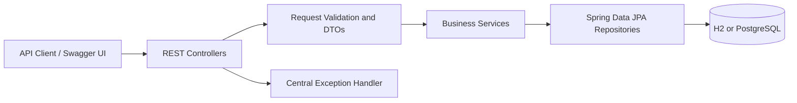

# Architecture

## Domain relationships

- A customer can have multiple subscriptions.
- A customer can place multiple service orders.
- Each subscription references one plan.
- Each service order references one plan.
- Inactive plans cannot be selected for new subscriptions or orders.
- Completed and cancelled orders are terminal states in the current workflow.
